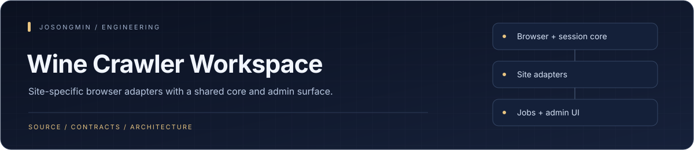
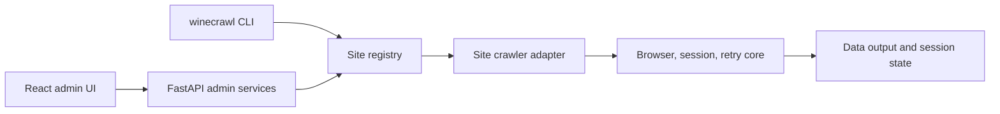

<p align="center"></p>

# Wine Crawler Workspace

<p align="center"><a href="#engineering-highlights">Engineering</a> · <a href="#architecture">Architecture</a> · <a href="#install-and-run">Get started</a> · <a href="#documentation">Reference</a></p>

An extensible Playwright collection workspace with site-specific crawlers, shared browser/session/retry infrastructure, a FastAPI administration API, and a React administration UI.

## Engineering highlights

| Mechanism | Engineering purpose | Source |
| :--- | :--- | :--- |
| **Explicit site registry** | Crawler factories are registered centrally. The current registry includes `example` and `burghound`; unknown names reject. | [Registry](src/wine_crawler/sites/registry.py) |
| **Layered Python package** | Configuration/logging, core primitives, sites, and admin layers have import-linter boundaries. | [Import policy](pyproject.toml) |
| **Shared browser/session handling** | The core owns reusable browser and session behavior rather than duplicating it in each site adapter. | [Browser core](src/wine_crawler/core/browser.py) |
| **Separate administration surface** | The admin API and React UI have their own dependency and execution requirements. | [Admin app](src/wine_crawler/admin/app.py) |
| **Typed frontend data flow** | The admin interface uses React Query, route-level pages, shared API wrappers, and widget composition. | [Frontend](admin-ui/src/shared/) |

## Architecture

<a id="architecture-at-a-glance"></a>



| Path | Responsibility |
| --- | --- |
| [src/wine_crawler/core](src/wine_crawler/core) | Browser, session, and retry primitives |
| [src/wine_crawler/sites](src/wine_crawler/sites) | Site implementations and registration |
| [src/wine_crawler/admin](src/wine_crawler/admin) | Job management, database, and API |
| [admin-ui](admin-ui) | Vite/React administration interface |
| [scripts](scripts) | Worker and operational helpers |
| [tests](tests) | Collection and administration tests |

The core must not import site, administration, or CLI layers. Python dependency boundaries are enforced through the import-linter contract in `pyproject.toml`.

## Install and run

Use Python 3.10+ and Node.js.

```sh
python3 -m venv .venv
source .venv/bin/activate
pip install -e ".[admin,dev]"
python -m playwright install

winecrawl sites list
winecrawl run example --limit 5
```

Run the administration backend and UI in separate terminals:

```sh
just admin-install
just backend-dev
just admin-dev
```

Default collection output is written to `data/<site>/<timestamp>.json`; browser sessions use `storage_state/<site>.json`. Keep sessions, cookies, and login material outside version control.

## Add a site and verify

1. Implement `src/wine_crawler/sites/<site>/crawler.py`.
2. Register it in `src/wine_crawler/sites/registry.py`.
3. Verify site-specific inputs, output, and failure behavior.

```sh
just check
just format
```

AWS execution uses the API/SQS/ECS-worker path and requires an actual account, queue, and permissions.

## Documentation

- [AWS deployment](docs/aws-deployment.md)
- [Contributor guide](AGENTS.md)
- [Command recipes](justfile)
- [Package and layer configuration](pyproject.toml)

<p align="center"><sub><a href="https://github.com/josongmin">Project map</a> · <a href="#engineering-highlights">Back to overview</a></sub></p>
